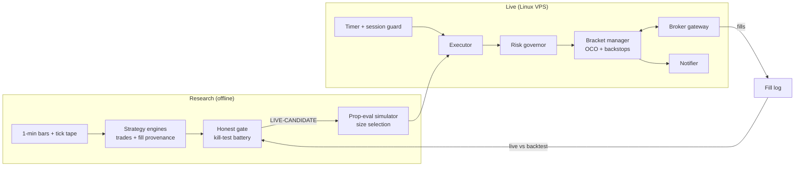

# futures-algorithm

**Execution-safety and research-validation infrastructure for intraday futures strategies.**

This is a curated public extraction of a larger private system that trades index futures live on a
Linux server. It shows how that system is engineered: how backtests are interrogated before they are
believed, and how live orders stay protected when the broker gateway misbehaves.

> **Public portfolio scope.** No live strategy rules or parameters, no broker connections, no
> credentials, no account data and no proprietary market data are included. Code here is a
> re-implementation of the private modules, refactored to run standalone on synthetic data.
> Nothing in this repository is financial advice, and no number in it describes real performance.

---

## System at a glance



Full design: [docs/ARCHITECTURE.md](docs/ARCHITECTURE.md).

---

## What's in here

### 1. The honest gate: don't believe the backtest

`src/fxlab/research/honest_gate.py`

Every candidate strategy must pass a battery of kill tests before it can trade. Verdicts are
**KILL**, **NEEDS-WORK** or **LIVE-CANDIDATE**, and skipping a critical check is never a pass.

| Check | What it catches |
|---|---|
| Per-year stability | An edge that only exists in one market regime |
| Sign permutation | Results indistinguishable from coin flips |
| Walk-forward | In-sample fitting that falls apart out of sample |
| Monte Carlo (IID + block bootstrap) | Sequence luck and understated drawdowns |
| Tick-calibrated fill stress | Edges that vanish with one extra tick of slippage |
| Adverse fill *(advisory)* | Resting limits that only fill on losers |
| Same-bar exit ordering | Wins booked on bars that touched both stop and target |
| Entry-fill ordering | Wins that may never have existed: the fill bar already reached the target |

The two ordering checks exist because several backtests in the private research log looked excellent
and were artifacts of fill ordering that one-minute data cannot resolve. Ambiguous winners are priced
on a **neutral 50/50 bound**, calibrated by replaying live trades against a recorded tick tape
(they resolved to the target 46% of the time).

The demo shows why this matters. A book that passes every classic test is still flagged:

```
CHECK                 STATUS DETAIL
per-year stability    PASS   2023:+1,926/PF1.54  2024:+2,495/PF1.72  2025:+94/PF1.07
permutation           PASS   mean +7.52/trade, p=0.0002 (5,000 sign shuffles)
walk-forward          PASS   train +2,561/PF1.47 | out-of-sample +1,954/PF1.67
monte carlo           PASS   P(final<0)=0.0%  p95 maxDD iid 797 / block 844
fill stress           WARN   cost-fragile | +1tk: +4,215/PF1.49 | ...
entry-fill ordering   WARN   entry+target 38.5% | booked +4,515 -> neutral +148 -> worst -4,220
VERDICT: NEEDS-WORK
```

Method and reasoning: [docs/RESEARCH_METHOD.md](docs/RESEARCH_METHOD.md).

### 2. Execution safety: keep every contract protected

`src/fxlab/execution/bracket.py`, `broker.py`, `risk.py`

A bracket manager places the entry and an OCO stop/target, then handles every way the gateway has
failed in production:

| Failure | Response |
|---|---|
| Protective stop **rejected** on a fast reversal | Flatten at market if price is past the stop; else resubmit once, then flatten |
| **Partial fills** | Protection sized to what filled; an extra bracket for each increment |
| OCO sibling **not confirmed cancelled** | Keep verifying after the book is flat; alert until confirmed |
| **Both legs filled** in a whipsaw | Detect the reversed position and flatten |
| Break-even stop move **silently ignored** | Read the order back; arm a synthetic watchdog that flattens at entry |
| **Naked position** | Independent poll of broker net position versus working protection |
| **Unknown** net position | Never flatten on missing data alone |

A deterministic `SimBroker` can be scripted to reject, partially fill, refuse cancels, ignore stop
moves or go silent, so each scenario is a reproducible test. A `RiskGovernor` enforces the account
rules: contract cap, daily loss lock, trailing-drawdown lock and session cutoff.

### 3. Research tooling

- `monte_carlo.py`: IID and circular block bootstrap. Block resampling keeps losing streaks intact, so
  drawdown estimates aren't understated. (The private system also fits a 2-state hidden Markov model
  for regime persistence.)
- `eval_sim.py`: bootstraps trades against prop-firm evaluation rules (profit target, trailing
  drawdown) to choose the largest size with near-zero bust risk.

### 4. Operations

- `ops/calendar.py`: disarms bots on exchange holidays and early closes, before they connect.
- `ops/notify.py`: background pushes with a guaranteed flush at shutdown, written after end-of-day
  summaries were silently lost to a daemon thread killed at process exit.
- `deploy/systemd/`: sanitized unit files. Books start dry-run; arming one is a single drop-in file.
  Executors never restart into a live session.

### 5. Incident log

[docs/INCIDENTS.md](docs/INCIDENTS.md): real production incidents (sanitized), each with a proven root
cause, the fix and the test that now guards it.

---

## Quickstart

No credentials or network access needed.

```bash
python -m venv .venv && source .venv/bin/activate
pip install -e ".[dev]"
pytest                      # 44 tests
python scripts/demo.py      # gate scorecards + execution failure replays
```

---

## Engineering evidence

| Capability | Where |
|---|---|
| Fill-ordering geometry, long/short mirrored, with probe-power tests | `research/honest_gate.py`, `tests/test_honest_gate.py` |
| Verdict logic (critical vs advisory checks) | `research/honest_gate.py::verdict` |
| Reject backstop, partial-fill re-arm, OCO over-fill, BE watchdog, naked check | `execution/bracket.py`, `tests/test_bracket.py` |
| Scriptable broker failure injection | `execution/broker.py::SimBroker` |
| Account-rule enforcement | `execution/risk.py` |
| Prop-eval pass/bust simulation | `research/eval_sim.py` |
| Block bootstrap drawdowns | `research/monte_carlo.py` |
| Shutdown-safe notifications | `ops/notify.py` |
| Dry-run-by-default deployment | `deploy/systemd/` |

## In the private system, not here

- Live executors and detectors for each strategy book, with replay gates that must reproduce the
  backtest trade for trade before any change ships
- Broker gateway adapters, a trade copier that fans orders out to follower accounts, and end-of-day
  reconciliation against broker account snapshots
- The research archive: data pipelines, 431 historical backtest results and the findings ledger
- Strategy rules and parameters

## Deliberate scope

- Fills in the simulator are simplified: limits fill at their price, stops and market orders at the
  current price. Queue position and market impact are not modeled.
- The example strategy in `strategies/` is a textbook illustration with arbitrary parameters. It is
  not traded.
- Prop-account rules vary by provider; values in tests are illustrative.

## How it's built

Developed with a multi-agent AI workflow: Claude Code plans and reviews, Codex agents implement in
parallel, and nothing merges without adversarial review and passing tests.
