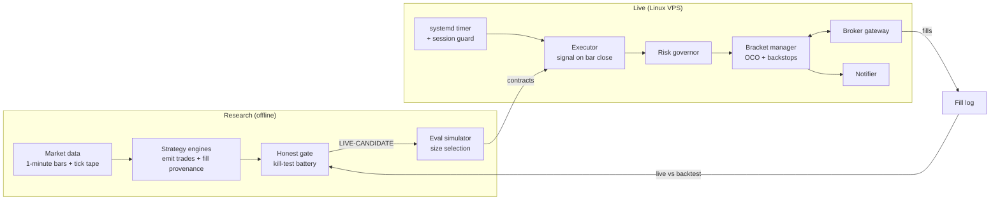

# Architecture

The private system has two halves that share one rule: **nothing reaches real money until it has been
tried against the failure modes that already happened once.**

## Research half

1. **Data.** About 1.1M one-minute bars of index-futures data (2022 onward) from a commercial vendor,
   plus a tick tape recorded from the live gateway. A written rule decides which source a study may
   use: if a result would change when price moves by one tick, it must use the authoritative source.
   Sources are never mixed inside one study.
2. **Strategy engines.** Each engine produces per-trade rows with a fixed schema. Engines that use
   resting limit orders also emit *fill provenance*: whether the fill bar also touched the stop or the
   target. Only the engine knows whether an order rested or was traded through, so the engine computes
   it, using one shared, tested function.
3. **The honest gate** (`src/fxlab/research/honest_gate.py`). A battery of checks every candidate must
   pass: per-year stability, a sign-permutation placebo, walk-forward out-of-sample, Monte Carlo,
   tick-calibrated slippage stress, and two fill-ordering checks. Verdict: KILL, NEEDS-WORK or
   LIVE-CANDIDATE. See [RESEARCH_METHOD.md](RESEARCH_METHOD.md).
4. **Eval simulator** (`src/fxlab/research/eval_sim.py`). Bootstraps trades against prop-account rules
   (profit target, trailing drawdown, daily loss limit) to pick the largest size with near-zero bust risk.
5. **Live feedback.** Every live fill is logged with requested versus filled price. Fill *rate* on
   resting limits is the one thing a backtest cannot see, so live fills feed back into the gate.

## Live half

| Component | Responsibility |
|---|---|
| systemd timer + session guard | Start each book before the session on weekdays; disarm on holidays and early closes. Never restart into a live session. |
| Executor | Build bars from the feed, run the strategy's detector on bar close, request an entry. Dry-run by default; a separate drop-in file arms live orders. |
| Risk governor | Contract cap, daily loss lock, trailing-drawdown lock, session cutoff. |
| Bracket manager | Place the entry and the OCO protection; handle rejects, partial fills, unconfirmed cancels, over-fills, ignored stop moves and naked positions. |
| Copier | Fan a leader's orders out to follower accounts, with a log-only mode that changes nothing on the leader. |
| Notifier | Background pushes during the session; blocking flush at shutdown. |
| Reconciliation | End-of-day comparison of the bot's own P&L against the broker's account snapshot. |

### Safety principles

- **Protection is sized to what actually filled,** never to what was requested.
- **A watchdog never trusts a single source.** The fill stream, order status and broker net position are
  cross-checked; an unknown net position never triggers a flatten on its own.
- **Verification outlives the position.** Cancels are confirmed even after the book is flat.
- **Reliability work stays off the order path.** New safeguards are added beside the order path, then a
  full-history replay must reproduce the backtest trade for trade (zero difference) before they ship.
- **Every change ships with a test** that reproduces the failure it fixes.

### Machines

| Machine | Role |
|---|---|
| Linux VPS | Live executors, data pulls, nightly reports. Nothing heavy runs here. |
| Development machine | Research, backtests, 100k-path Monte Carlo. |
